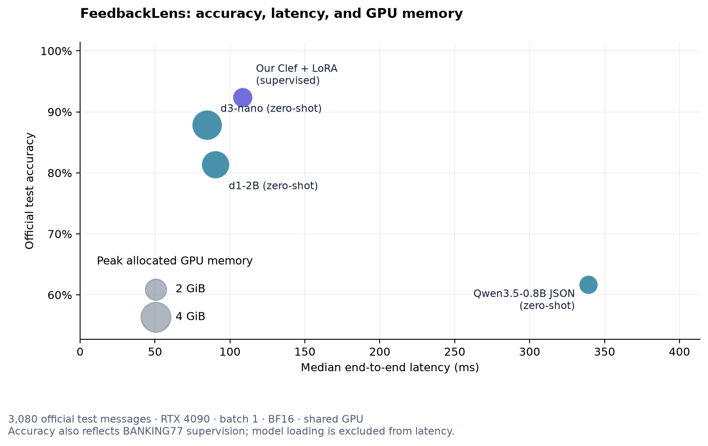

# FeedbackLens

BANKING77 intent classification: a supervised Qwen3.5-0.8B Clef decision head + LoRA versus zero-shot Qwen structured JSON, LiquidAI d1-2B, and d3-nano. The Streamlit demo accepts pasted messages and CSVs, shows all 77 decision probabilities, exports predictions, and compares measured accuracy, macro-F1, latency, and GPU memory.

**Trained checkpoint:** [Keerthunb/FeedbackLens-Qwen3.5-0.8B-BANKING77](https://huggingface.co/Keerthunb/FeedbackLens-Qwen3.5-0.8B-BANKING77) · **[Model card](MODEL_CARD.md)**

## Run

Linux, Python 3.11, and an NVIDIA GPU are required for the measured configuration. Install [uv](https://docs.astral.sh/uv/getting-started/installation/) first. For a fresh installation:

```bash
bash scripts/setup.sh
.venv/bin/python scripts/fetch_models.py
.venv/bin/python -m feedbacklens prepare --revision 1846984189f2bc0ac51c6fc3a600fa9e1714e0c6
.venv/bin/hf download Keerthunb/FeedbackLens-Qwen3.5-0.8B-BANKING77 --revision 4b1d3f242a9014a0698bc329b4c903b5403ca0d1 --local-dir artifacts/decision/best
CUDA_VISIBLE_DEVICES=0 .venv/bin/python -m feedbacklens verify-checkpoint
FEEDBACKLENS_GPU=0 .venv/bin/streamlit run app.py --server.address 127.0.0.1 --server.port 8507
```

The d1 worker uses `.venv-d1` (Transformers 5.19); training and the other backends use `.venv` (5.17). Both use the same torch/CUDA build. `configs/models.json` pins model and remote-code revisions. Setup pins the tested packages and omits unused xformers/torchao integrations. The app loads one model at a time, serializes requests, and releases the previous model when switching. CSVs need a nonempty `text` column; each pasted line is one message.

Trained weights, dataset rows, and local logs are excluded from Git. The Hugging Face download provides the trained LoRA adapter, FP32 Clef head, tokenizer, and schema; base weights are fetched separately by `fetch_models.py`. To train from scratch instead, use `CUDA_VISIBLE_DEVICES=0 .venv/bin/python -m feedbacklens train`. The zero-shot models can be used after fetching their weights. The committed benchmark dashboard is available independently of training. The commands use GPU 0; the recorded benchmark runs used physical GPU 2.

## Reproduce

```bash
CUDA_VISIBLE_DEVICES=0 .venv/bin/python -m feedbacklens train --output artifacts/replay
CUDA_VISIBLE_DEVICES=0 .venv/bin/python -m feedbacklens verify-checkpoint --output artifacts/replay
CUDA_VISIBLE_DEVICES=0 .venv/bin/python -m feedbacklens predict --checkpoint artifacts/replay/best --text 'My card has not arrived yet.'
.venv/bin/python scripts/run_benchmarks.py --gpu 0
.venv/bin/python -m pytest -q
```

The benchmark runner loads `artifacts/decision/best` by default. For another checkpoint use `feedbacklens benchmark --model decision --checkpoint artifacts/replay/best`; run d1 with `.venv-d1/bin/python`. Use `train --output artifacts/replay --resume artifacts/replay/checkpoint-<step>` to resume optimizer/RNG state in the same run directory. Run `prepare` before the dataset tests. `--limit` produces smoke results only; `summarize` requires every official test row for all four models.

## Data and protocol

The [PolyAI/BANKING77 dataset](https://huggingface.co/datasets/PolyAI/banking77) has 77 labels. Preparation retains all **3,080 official test rows** and removes **25** overlapping training rows, **30** normalized duplicates, and **2** conflicting-label rows. The remaining data are stratified into **7,956 train / 1,990 validation** messages (seed 3407). Duplicate keys use Unicode NFKC, case folding, word tokens, and collapsed whitespace. Test-internal duplicates remain intact. `data/audit.json` records source revision, row counts, hashes, and class support. This prevents normalized exact leakage; semantic paraphrases and unknown upstream pretraining contamination are outside this audit.

All models receive the same messages, question, descriptions, and official option order from `configs/intents.json`. There is one choice question over all 77 intents. Qwen JSON uses `enable_thinking=False`, greedy generation, and a token trie restricting the entire response to an exact JSON label. Strict parsing rejects malformed responses; invalid labels count as incorrect and remain in all denominators. The decision baselines use their official `system_one` APIs. Their prompt serialization and architectures differ, while semantic inputs match.

The training implementation adapts [Unsloth's official decision notebook](https://github.com/unslothai/notebooks/blob/59d5a1b8216e5f67c5e3ccf37a5ecae94a950a14/nb/Qwen3_5_%284B%29-Decision.ipynb): a new width-512 Clef head, two routing layers, four decoder layers, and rank-16 LoRA; three epochs, effective batch 32, cosine LR, and best validation-loss selection. Calibration uses validation only. The test set is never loaded by training. The final export preserves the FP32 head using the pinned trainer exporter; the public inference export would round it to BF16. The saved notebook and its SHA-256 are under `references/`.

Inference measurements use batch **1**, **10** identical validation-message warmups, BF16 backbones without quantization, and the same physical RTX 4090 for every model. `perf_counter_ns` is bounded by CUDA synchronization. Each measurement includes tokenization, model execution/generation, decoding, parsing, and probability conversion. Loading, warmup, disk output, scoring, and process sampling are excluded. Peak allocated and reserved memory include the resident model and inference tensors, measured by PyTorch after warmup; they exclude other processes and driver allocations. Decision heads and numerical-stability components can remain FP32; each report lists parameter dtypes. GPU process samples disclose co-tenancy. Latencies on a shared GPU are descriptive local measurements and should not be treated as isolated-hardware speed claims.

## Results and artifacts

<!-- RESULTS:start -->
Measured on the full official test split. See [benchmark cards](results/BENCHMARKS.md) and raw reports for the protocol, software versions, and GPU contention records.

| Model | BANKING77 regime | Accuracy | Macro-F1 | Median / p95 ms | Peak GPU GiB |
|---|---|---:|---:|---:|---:|
| Our Qwen Clef + LoRA | supervised | 92.40% | 0.9238 | 108.43 / 114.26 | 1.890 |
| Qwen3.5-0.8B JSON | zero-shot | 61.69% | 0.6045 | 339.13 / 486.57 | 1.711 |
| LiquidAI d1-2B | zero-shot | 81.33% | 0.8062 | 90.27 / 94.59 | 3.650 |
| d3-nano | zero-shot | 87.82% | 0.8728 | 84.77 / 88.02 | 4.238 |

Training: **130.48 min**, **2.776 GiB** peak allocated GPU memory. Fresh checkpoint reload restored every head/adapter tensor exactly and matched all 8 validation labels. Probability differences are recorded separately in the verification report; BF16 inference is not bitwise reproducible across these processes.


<!-- RESULTS:end -->

- `feedbacklens/{prepare,train,evaluate,inference}.py`: reusable pipeline modules; `python -m feedbacklens --help` lists commands.
- `artifacts/decision/best/`: LoRA weights, exact FP32 head, tokenizer/processor, model revision, schema, and run configuration.
- `artifacts/decision/training_report.json`: training time, peak GPU memory, selection history, and calibration. Training time includes validation/checkpoint saves, excludes loading/preparation/final calibration/export.
- `artifacts/decision/reload_verification.json`: exact loaded head/adapter tensor checks, configuration/tokenizer checks, validation-label agreement, probability differences, and checkpoint hashes. The independent runtime check is saved as `reload_verification_repro.json`. Confidence differences between the training and fresh BF16 processes remain a numerical reproducibility limitation; their precise cause is unresolved. The original stricter probability comparison is preserved under `artifacts/decision/diagnostics/initial_reload_verification.json`.
- `results/<model>.json`: full metrics, per-class scores, confusion matrices, software versions, and hardware/process records. Public reports redact process IDs and machine-specific paths; measurements remain unchanged. Benchmarking regenerates local `.predictions.jsonl` files with every prediction, probability, and timing; these row-level exports are excluded from Git.
- `tests/`: leakage and integrity checks, constrained-output validation, and invalid-prediction scoring. The optional scripts below exercise real demo inference and downloads.

BANKING77 is CC BY 4.0: Iñigo Casanueva et al., *Efficient Intent Detection with Dual Sentence Encoders*, 2020. Model and Unsloth licenses remain those of their upstream projects. This is a closed-set intent demo: unrelated messages still receive one of the 77 banking labels.

The optional browser check uploads CSV data, runs real inference, verifies downloaded files and all 77 probabilities, and saves screenshots under `results/browser/`:

```bash
uv venv .venv-browser --python .venv/bin/python
uv pip install --python .venv-browser/bin/python playwright==1.65.0
.venv-browser/bin/playwright install chromium
.venv-browser/bin/python scripts/check_browser.py --url http://127.0.0.1:8507 --model decision
```
